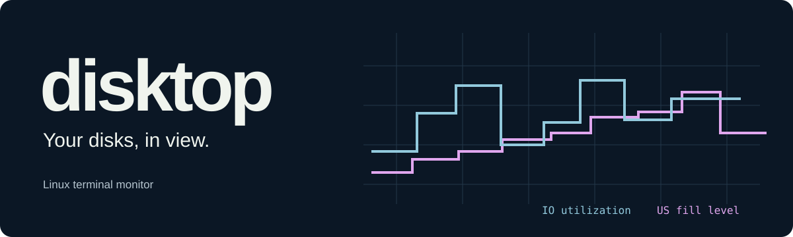
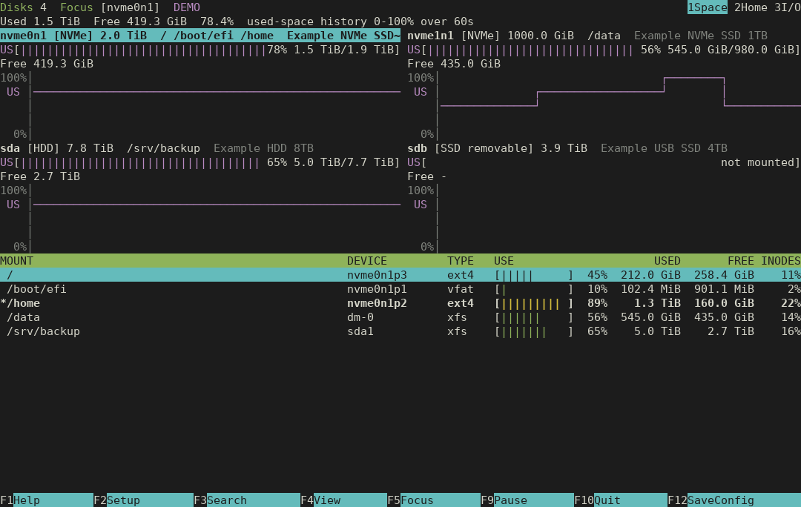

<p align="center">
  <a href="https://disktop.wutz.io">
    
  </a>
</p>

<p align="center">
  <strong>Linux disk activity and storage use. Right in your terminal.</strong><br>
  All disks at once, per-process I/O, filesystems, <code>/home</code> sizes and F2 Setup —
  inspired by htop and nvtop, the disk counterpart of
  <a href="https://github.com/itmitalles-de/nwtop">nwtop</a>.
</p>

<p align="center">
  
  <a href="Cargo.toml"></a>
  <a href="LICENSE"></a>
</p>

<p align="center">
  <a href="https://disktop.wutz.io">Website</a> ·
  <a href="#install">Install</a> ·
  <a href="#keyboard">Keyboard</a> ·
  <a href="https://github.com/itmitalles-de/spctop">Source</a>
</p>

**spctop** (formerly disktop) watches **used space across all your disks**.
The main view combines used/free capacity, fill-level history and a filesystem
table. Open Home to find large directories and watch growth between scans.
Disk throughput, utilization and process I/O live in a separate **I/O** view,
accessible from the F4 view menu.

The compact htop/nvtop-style layout keeps your terminal's ANSI palette and
works in a split terminal, including 36 × 16.

**Start without sudo.** The interface runs as your regular user and shows
disk and filesystem capacity, plus directory sizes you may read. An optional
one-time helper setup adds directory sizes below administrator-approved roots
(default `/home`) and other users' process I/O in the secondary view; the
interface itself never gains privileges.

<p align="center">
  
  <br>
  <sub>Actual terminal output in explicit DEMO mode. Disks, rates and processes are synthetic.</sub>
</p>

| At a glance | Under your control |
| --- | --- |
| **All disks** | Used/free space, fill percentage and history per disk |
| **Filesystems** | Capacity, used/free space and inodes; `*` marks home |
| **Home sizes** | Background scan, drill-down, share of parent, growth between scans |
| **I/O submenu** | Disk RD/WR/IO, IOPS, await and process I/O, when needed |
| **F2 Setup** | Focus, refresh rate, colors, view, home path; save with F12 |

## Install

You need **Linux** and **Rust 1.88+**. The source is licensed under the
[GNU GPL v3 or later](LICENSE).

```bash
git clone https://github.com/itmitalles-de/spctop.git
cd spctop
./scripts/install.sh
./scripts/setup-helper.sh   # Optional, one-time administrator authentication.
~/.local/bin/spctop
```

The installer builds from source and installs the UI into `~/.local/bin` as your
regular user. Add that directory to your `PATH`, then start with `spctop`.

<details>
<summary><strong>Installation, updates, and permissions</strong></summary>

`scripts/install.sh` runs `cargo build --release --locked`. It only replaces an
unchanged executable previously installed by that script; unrelated files,
symlinks and modified executables are preserved.

Without the helper, Linux only lets you read `/proc/PID/io` of your own
processes and only scan directories you may read. spctop shows exactly that and
says how many processes are hidden; it never fills the gap with estimates.

`scripts/setup-helper.sh [--allow-shared-group] [--allow-owner-change]` builds
as your regular user and requests administrator authentication through `pkexec`
(or `sudo`) only to install `/usr/local/libexec/spctop-collector`, owned by
root, mode `0750`, executable by root and your primary group. **Members of that
group can see all processes' storage I/O and the names and sizes of the
directories below the allowed scan roots** (never file names or contents). Its
file capabilities are only `CAP_DAC_READ_SEARCH` and `CAP_SYS_PTRACE`.

- **Trust:** root runs the setup script from your checkout and installs the
  binary you built, so the administrator who authenticates must trust that
  checkout and build. The root side copies the build root-only first, checks it
  against the digest of your build, refuses symlinked build paths, and only then
  sets the group, mode and capabilities.
- **Shared groups:** setup refuses a primary group that is or may be shared: its
  name differs from your user name, it lists other members, other accounts use it
  as primary group, or its members cannot be listed reliably. Use a user-private
  group, or pass `--allow-shared-group` only if every member may see this.
- **Owner change:** if the helper is already installed for another group (after
  another user ran setup), setup refuses to move access unless
  `--allow-owner-change` is given.
- **Scan roots:** the helper scans only directories at or below the absolute
  paths listed one per line in `/etc/spctop/scan-roots` (`#` comments allowed);
  when absent, the legacy `/etc/disktop/scan-roots` is used if present.
  Only when both files are absent is `/home` the default. The file and its directories must be
  root-owned and not writable by group or others, otherwise nothing is scanned
  with privileges. Below an allowed root the path is opened component by
  component without following symlinks, so a link such as `/home/alice/x ->
  /root` is refused. For any other path the interface scans without the helper,
  as if it were not installed, and says so. An administrator adds roots with,
  for example, `echo /srv/home | sudo tee -a /etc/spctop/scan-roots` (create
  the file with `/home` first to keep the default).
- **hidepid:** if `/proc` is mounted with `hidepid`, the helper keeps that policy
  for other users' processes although `CAP_SYS_PTRACE` bypasses it:
  `hidepid=1`/`noaccess` sends only their task name, never the command line;
  `hidepid=2`/`invisible`/`ptraceable` omits them and counts them as hidden.
  Members of the `gid=` group of the mount see everything, as without the helper.
  Direct collection also warns about hidepid; mode 2 hides enumeration, so the
  total hidden count is explicitly unknown. The TUI shows the restriction even
  when the kernel makes counting impossible.
 The sampling thread keeps both to read other users'
`/proc/PID/io`; the home scanner thread keeps only `CAP_DAC_READ_SEARCH`. Both
set `NO_NEW_PRIVS`; core dumps are disabled and the inherited environment is
cleared at start.

The UI starts the fixed helper over private stdin/stdout pipes with a bounded,
versioned protocol: no service, port, or arbitrary file/command API. Replies have
a deadline; a stalled, crashed, outdated or revoked helper is replaced by direct,
unprivileged collection at startup or at runtime, with a visible notice.

Repeat the helper setup after updating spctop. A helper from an older release
keeps working: the interface adds what it does not send (fill levels and the
disks below dm/md devices, which need no privilege) and suggests rerunning the
setup once. `--no-helper` bypasses an
installed helper. An administrator revokes access by removing
`/usr/local/libexec/spctop-collector` and its receipt
`/usr/local/libexec/.spctop-collector.sha256`. For an upgraded installation,
also retire the legacy helper as described below.

</details>

## Use

```bash
spctop                          # All disks; focus on the disk of /home.
spctop --device sda             # Focus a block device (also /dev/sda).
spctop --device all             # No focus: summary of physical whole disks.
spctop --view filesystems       # Default space overview; also home or io.
spctop --view io                # Disk throughput and process I/O.
spctop --home-path /srv/homes   # Tree for the home view (default /home).
spctop --interval 0.5 --history 120
spctop --view io --sort write    # Sort the secondary process I/O table.
spctop --all-devices            # Also show loop, ram and zram devices.
spctop --no-color               # Start in monochrome (also NO_COLOR=1).
spctop --once                   # Print one measured snapshot (all disks) and exit.
spctop --json                   # Machine-readable snapshot (stable, English).
spctop --json --scan-home       # Include a complete home scan.
spctop --demo                   # Clearly labeled synthetic UI preview.
```

The default refresh interval is **1 second** (`-d`, 0.1–60 s); history defaults
to **60 seconds** (`--history`, 10–600). `-s` sorts processes by `io`, `read`,
`write`, `total`, `pid` or `command`.

## Keyboard

| Key | Action |
| --- | --- |
| <kbd>F1</kbd> / `?` | Help |
| <kbd>F2</kbd> | Open Setup |
| <kbd>F3</kbd> / `/` | Search the current table |
| <kbd>F4</kbd> / `v` | Open the view menu: Space / Home / I/O |
| `1`, `2`, `3` / `i` | Space, Home, I/O; Esc returns from I/O to Space |
| <kbd>F5</kbd> / `d` | Focus a device; Tab / Shift+Tab cycle the disks |
| <kbd>F6</kbd> | I/O view: choose the process sort column; `s` cycles it |
| <kbd>F9</kbd> / Space | Pause or resume the display |
| <kbd>F12</kbd> | Save current settings |
| Enter / → , Backspace / ← | Home view: open a directory / go up |
| `r`, `a` | Home view: rescan now / allocated vs. apparent size |
| ↑ / ↓, Page Up / Page Down, Home / End | Move through the table |
| `q` / <kbd>F10</kbd> / Ctrl+C | Quit; `q` closes overlays, F10 returns from Setup |

### All disks at once

The default **Space** view gives every whole disk its own block with used and
free space, a fill-level meter and fill history on a 0–100% scale. Filesystems
below the disks show capacity, used/free space and inodes. **Home** provides
sizes and growth for directories below the configured scan root.

**F4** opens the view menu. Choose **I/O** for read/write meters, utilization
history, IOPS, await, queue depth and the process table. All disks share one
RD/WR scale: the highest read or write rate in visible history, so equal bar
lengths mean equal rates across disks. I/O remains available without crowding
the space views.

Fill level uses the filesystems mounted from a disk, its partitions and
stacked devices such as LUKS, LVM or MD, counted once. `not mounted`,
`swap only` and `-` distinguish disks with no filesystem, swap and unavailable
measurements. Partitions, loop, ram and zram are hidden by default; F2 Device
controls visibility. Stacked devices backed by one shown disk are folded into
it unless explicitly enabled; multi-disk stacked devices retain their blocks.

Wide terminals arrange disk blocks in columns. Small terminals reduce graph
height and then collapse blocks; `+N more` marks hidden disks and Tab scrolls
the focus. F5/Tab/`--device` select the focused disk; automatic focus follows
the configured home path.

### Make it yours with F2

Setup has **General**, **Device**, **Chart**, **Table** and **Home** panels:
refresh interval, colors, language, focus (Auto follows the disk holding the
home path), loop/ram/zram and stacked-device visibility, graphs and history, the IO and fill-level
graph series, read/write/fill-level colors, view, sorting, idle processes,
process rows, the home path (Enter edits, Enter applies, Esc cancels), the
rescan interval (1 minute to 24 hours) and allocated vs. apparent sizes.
Changes apply immediately; **F12 saves them for the next start**.

The terminal interface is available in English and German. **Auto** follows
`LC_ALL`, `LC_MESSAGES` or `LANG`; General › Language fixes either. Command-line
help, errors, `--once` and `--json` stay English.

<details>
<summary><strong>Settings file and command-line overrides</strong></summary>

Settings are saved atomically with private permissions to
`$XDG_CONFIG_HOME/spctop/config.json` or `~/.config/spctop/config.json`.
Command-line options and `NO_COLOR` apply to that run only; F12 keeps the saved
values and adds only what you changed in Setup or with keys. Malformed settings
produce a warning, defaults are used and the file is preserved; unknown keys are
kept; settings files from older versions get defaults for newer options. A
saved device that no longer exists falls back to automatic selection for that
run. As root, spctop refuses to save into another user's settings
directory.

</details>

## What the numbers mean

Device rates are deltas of the kernel's **/proc/diskstats** counters, whose
sectors are always 512 bytes. Utilization is the share of time with requests in
flight; await is the average request time; `qd` the average queue depth. The
kernel prints the time counters as 32-bit values; their wrap (about every 1.5
days for the queue-depth counter under load) is handled. A counter reset or a
re-plugged device shows `-` for one interval instead of a wrong rate. Size and
device-mapper names are re-read every refresh, so inserted media, resized or
renamed volumes show their current values. **All** adds physical whole disks only, since partitions, device
mapper (LVM, LUKS) and MD RAID would count the same I/O twice.

The fill level comes from `statvfs` of the filesystems listed in the
Filesystems view, mapped to disks through partitions and holders in sysfs.
Like `df`'s Use%, it is used / (used + available), so blocks reserved for root
count as full and the shown total is used + available. A multi-device btrfs
filesystem counts on each of its member disks; the all-disks total counts a
filesystem spanning several disks (btrfs, LVM, MD) once. ZFS pools count on all
known member disks, using pool-wide size/allocated/free from `zpool list`;
the all-disks total counts each pool once across disks and mounted datasets.
The Filesystems view keeps each dataset's own quota-dependent `statvfs`
values. ZFS discovery needs the optional OpenZFS `zpool` tool; queries are
bounded and run without helper capabilities. Missing tools, unresolved vdevs
and failed queries are reported instead of inferring pool capacity from
datasets. File-backed vdevs have no inferred disk attribution. Swap
partitions come from `/proc/swaps` and are not part of the fill level.

`--json` adds a `usage` object to every device (`filesystems`, `unmeasured`,
`total_bytes`, `used_bytes`, `available_bytes`, `swap`, `block_devices`,
`accounting_keys`; `null`
when not measured, for example by a helper from an older release) and
`backing_disks`, the whole disks below a dm, md or other stacked device (bcache,
DRBD, ZFS volumes and nbd are kind `stacked`, shown as `VIRT`). Filesystems
carry `not_responding` and, for multi-device btrfs or ZFS, `member_devices`.
ZFS rows also carry a `zfs` object with pool `name`, `total_bytes`, `used_bytes`,
`available_bytes` and an optional `error`, separate from dataset values. A snapshot
lists kernel files that exceeded the 16 MiB read limit in `truncated`. The document version
stays 1 because fields are only added. `--once` lists every disk of the
overview with used/free space and fill level; `--view io --once` adds the
I/O-focused report.
`block_devices` remains a list of real block-device names; `accounting_keys`
deduplicates ordinary filesystems by device and ZFS pools by `zfs:<pool>`.
Update UI and helper together to get the new ZFS accounting; older clients
do not understand pool-wide totals.

Process rates come from the per-thread counters in
**/proc/PID/task/TID/io**: `read_bytes` and `write_bytes` are bytes a thread
caused to be read from or dirtied for storage, across all devices. The process
total in /proc/PID/io (shown as the cumulative `read_bytes`/`write_bytes` in
`--json`) also contains the lifetime I/O of reaped children, so a shell would
otherwise show a finished `cp`'s gigabytes in one interval. I/O of a thread in
its last interval before it exits is not shown. **They cannot be attributed to a device**, exclude page-cache hits, and
count writes when data is dirtied rather than at writeback. Cancelled writes
(dirty data truncated before writeback) are charged to the truncating process,
which need not be the writer, so they are shown separately. Processes that exit
between two refreshes are not listed; their I/O remains in the device rates.

<details>
<summary><strong>Filesystems and the home scan</strong></summary>

- Filesystems lists block-backed mounts plus btrfs and ZFS. Pseudo and memory
  filesystems (proc, tmpfs, overlay, …) are skipped, as are network and FUSE
  filesystems, because `statvfs` on an unreachable server can hang. Over-mounted
  filesystems, which no path reaches, are skipped; bind mounts of the same
  filesystem root are shown once. `*` marks the filesystem that contains the home
  path; none is marked when the home path is on a network, memory or FUSE
  filesystem.
- `stat`/`statvfs` of block-backed mounts (including FUSE block devices such as
  ntfs-3g) run in a worker thread with a 0.5-second timeout. A mount that does
  not answer, for example a stuck FUSE daemon or a failing disk, is shown as
  `not responding` and skipped until its call returns; the monitor keeps running
  and `--once`/`--json` finish. The home path's symlinks are resolved off the
  sampling thread, too.
- The home scan runs in a background thread with idle I/O priority. It stays on
  one filesystem, never follows symlinks (each directory is opened relative to
  its parent with `O_NOFOLLOW`), counts hard-linked files once, and never reads
  file contents. Sizes are allocated blocks (`du`) or apparent sizes (`du -b`).
- Scans are bounded: 20 million entries, 15 minutes, 128 directory levels. The
  retained tree keeps 20,000 directories, sharing retention between top-level
  subtrees and lending unused shares to others. Within each subtree it prefers
  shallower and then larger directories, with at most 200 subdirectories per
  directory. One home full of large directories cannot monopolize all retained
  detail. If the root children themselves exceed a limit, some must still be
  summarized; discarded details cannot be recovered during that scan.
  The rest is summarized as
  "smaller dirs" and still counted in every total. Directories that could not be
  read are marked partial (`!`).
- Growth columns compare each retained directory with the previous scan and the
  first scan of this session. Names are shown with control characters,
  bidirectional overrides and invalid UTF-8 escaped (`\xNN`, `\u{NNNN}`).

</details>

## Development

```bash
cargo fmt --check
cargo clippy --locked --all-targets -- -D warnings
cargo test --locked
cargo build --release --locked
shellcheck scripts/*.sh
python3 tests/terminal.py target/release/spctop
python3 tests/setup.py target/release/spctop
```

<details>
<summary><strong>Isolated I/O and helper tests</strong></summary>

These run as root inside a disposable container with a read-only repository
mount and no network:

```bash
docker build -t spctop-test tests
docker run --rm --network none -v "$PWD:/work:ro" spctop-test \
  python3 tests/live_io.py --isolated target/release/spctop
docker run --rm --network none --cap-add DAC_READ_SEARCH --cap-add SYS_PTRACE \
  -v "$PWD:/work:ro" spctop-test python3 tests/helper.py --isolated \
  target/release/spctop target/release/spctop-collector
```

`tests/live_io.py` has separate unprivileged writer and reader processes write
and fsync a file on the container's disk-backed layer and read it back after
dropping its cached pages; spctop must attribute the bytes to the right PIDs
and the physical disks must show the writes. `tests/helper.py` checks the
installer, per-thread capabilities, the cleared helper environment, root
processes visible only through the helper, a private home directory scanned
completely only through the helper without file names leaving it, protocol
bounds, and shutdown or fallback with a stopped or killed helper.

[CI](.github/workflows/ci.yml) runs formatting, linting, tests on stable and
Rust 1.88.0, the release build, the terminal and Setup checks, both container
tests, ShellCheck and a dependency audit.

Real hard-NFS outages and `/proc hidepid` policies are covered by the separate
[disposable-VM tests](tests/kernel.md); [ZFS validation](tests/zfs.md) uses a
disposable mirror with multiple datasets and a quota. These kernel scenarios
were exercised on Ubuntu 24.04/KVM; they are not run in ordinary CI containers.

</details>

See [AGENTS.md](AGENTS.md) for repository-specific contributor instructions.

The [project website](https://disktop.wutz.io) is a dependency-free static site in
[`site/`](site/), published by the [Pages workflow](.github/workflows/pages.yml).
Its terminal images and recording use explicit DEMO mode with synthetic data.

## License

Copyright (C) 2026 itmitalles

spctop is free software: you can redistribute it and/or modify it under the
terms of the GNU General Public License as published by the Free Software
Foundation, either version 3 of the License, or (at your option) any later
version (SPDX: `GPL-3.0-or-later`). spctop is distributed in the hope that it
will be useful, but WITHOUT ANY WARRANTY; without even the implied warranty of
MERCHANTABILITY or FITNESS FOR A PARTICULAR PURPOSE. See [LICENSE](LICENSE) for
the full license text.

The self-hosted website fonts are licensed separately under the SIL Open Font
License; see [`site/assets/fonts/`](site/assets/fonts/).

---

[GPL-3.0-or-later](LICENSE) · Inspired by htop, nvtop and iotop.

### Upgrading from disktop

Run both installation scripts to install `spctop` and `spctop-collector`.
Legacy `disktop/config.json` preferences are read when no spctop configuration
exists; saving writes to `spctop/config.json` and preserves the old file.
The old process-first view migrates to the Space overview.

The privileged scanner uses `/etc/spctop/scan-roots`; when absent, an existing
`/etc/disktop/scan-roots` remains authoritative. Only when both are absent does
the `/home` default apply. An invalid policy fails closed.

The installers leave any legacy executable untouched. After validating spctop,
remove `~/.local/bin/disktop` and `~/.local/bin/.disktop-install.sha256`.
An administrator can retire `/usr/local/libexec/disktop-collector` and
`/usr/local/libexec/.disktop-collector.sha256`; removing only the new helper
does not revoke the old helper's access. Keep old settings until migration
is verified. The website remains at https://disktop.wutz.io.
